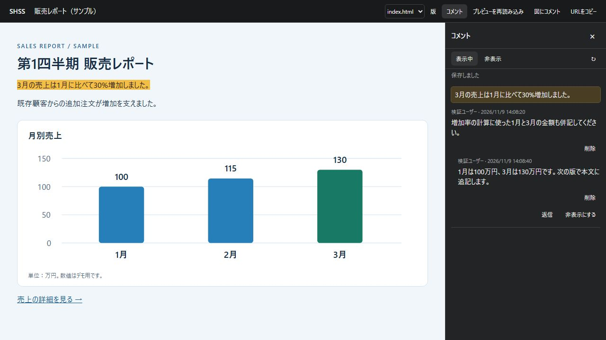
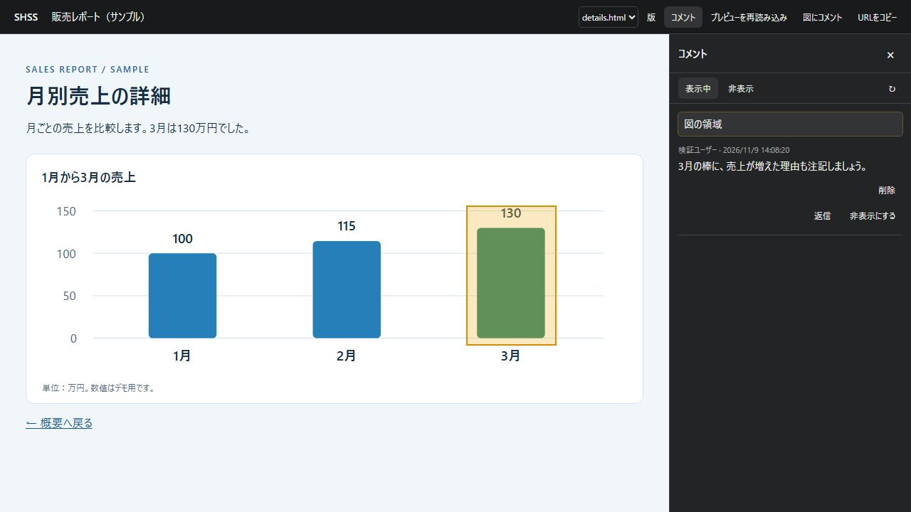

# Google SHSS

[日本語](README.md)

Google SHSS is a Google Apps Script web app for reviewing HTML reports and figures within a Google Workspace domain. It stores document versions and comments in Google Drive and provides links that open a specific version.

The app interface is in Japanese.

## Screenshots and features

These screenshots show the app running locally with a fictional sales report.

### Comment on text

Select text in the preview to open the comment field on the right. Press **Ctrl+Enter** or click **投稿** (Post) to submit. Click a quoted passage in the sidebar to highlight it in the preview. You can reply to threads and delete your own posts.



### Comment on part of a figure

Choose **図にコメント** (Comment on a figure). Click an image or chart to select the whole figure, or drag to outline a smaller area. The screenshot shows a saved comment attached to the March bar.



### Open external references

Click an HTTPS link in a document to see the destination. Review the address, then select **別タブで開く** (Open in new tab).

### Import, navigate, and share

- Choose an HTML, ZIP, or static SVG file under **取り込み** (Import) to start importing it. You can edit the title while the import runs. Closing the dialog does not stop the import; a notice appears when it finishes. **保存状況** (Save status) shows progress and lets you retry a failed import.
- Switch between pages in a ZIP package using the page menu or links in the document. Comments are saved for each version and page.
- Use **版** (Versions) to open an earlier version. Use **URLをコピー** (Copy URL) to share a direct link to the version and page you are viewing. Readers and commenters need the relevant Drive permissions.
- Use **プレビューを再読み込み** (Reload preview) to reset the HTML's interactive controls, such as tabs, to their initial state.

## Requirements

- A Google Workspace account with access to Apps Script and Google Drive
- Node.js 22 and npm to build the project
- A dedicated Google Drive folder for imported documents

## Build

```sh
git clone https://github.com/soudai/google-shss.git
cd google-shss
npm ci
npm run build
node --check < dist/gas/Code.gs
```

The build produces `Code.gs`, `Index.html`, and `appsscript.json` in `dist/gas/`.

`npm test` runs the tests for import sanitization and comment handling. `npm run check` runs the tests, the build and the syntax check together.

## Deploy to Apps Script

1. Create a standalone project in [Apps Script](https://script.google.com/). Enable manifest visibility in Project Settings and add the three generated files. Name the HTML file `Index` in the editor.
2. The generated manifest enables the [Advanced Drive Service (v3)](https://developers.google.com/apps-script/advanced/drive). If your script uses a standard Google Cloud project, enable the Google Drive API in that project as well.
3. Add the following script properties in Project Settings.

   | Property | Value |
   | --- | --- |
   | `SHSS_ROOT_FOLDER_ID` | The ID of the storage folder in Drive. Copy the part after `/folders/` in the folder URL. |
   | `SHSS_DOMAIN` | The Google Workspace email domain for your users, such as `example.com`. |

4. Create a [new web app deployment](https://developers.google.com/apps-script/guides/web). Set **Execute as** to **User accessing the web app** and limit access to **users in your domain**.
5. Open the generated `/exec` URL with an account in that domain and grant access to Google Drive, your email address, and external connections when prompted. External connections are used to read several Drive files in parallel; the app connects only to `www.googleapis.com`.

To update the app, replace the generated files and assign a new version to the existing deployment under **Manage deployments**. The existing `/exec` URL will continue to work. When an update adds permissions to the manifest, each user is asked to grant them the next time they open the app.

## Try it

1. Open the web app with an account that can add files to the storage folder.
2. Save this sample as a UTF-8 file named `review-sample.html`. Choose **取り込み** (Import) and select the file.

   ```html
   <!doctype html>
   <html lang="en">
   <meta charset="utf-8">
   <title>Review sample</title>
   <p>Select this sentence and post a comment.</p>
   </html>
   ```

3. Select the sentence, type a comment, and press **Ctrl+Enter**. When **保存しました** (Saved) appears, reload the page, confirm the comment is there, and delete your own comment.
4. To test with another account, grant it Viewer access to the document folder in Drive. To let it post, also grant it Editor access to that document's `comments.json`. Copying the web app link does not change Drive permissions.

## Data and limits

- Imported documents, version metadata, and comments are stored in your configured Drive folder. Users with edit access to `comments.json` can modify the file directly in Drive. Deleting a comment in the app hides it and retains its text in the JSON file.
- A single UTF-8 HTML file can be up to 10 MiB and a static SVG up to 512 KiB. ZIP limits are 10 MiB compressed, 20 MiB uncompressed, 100 files, and 20 HTML pages. Individual files inside ZIPs can be up to 2 MiB (512 KiB for SVGs). Importing from a Drive URL or file ID supports single HTML files.
- Include images, CSS, and classic JavaScript in the ZIP package. Pages that depend on external CDNs or APIs, ES modules, or form submission are outside the supported scope. HTML JavaScript runs in a sandboxed preview. Import files from authors you trust.
- Comment bodies are limited to 2,000 characters. New posts are restricted as comment storage or operation history approaches its limits. Back up comment files regularly to a Drive folder accessible only to your administrators.

## License

[MIT](LICENSE)
