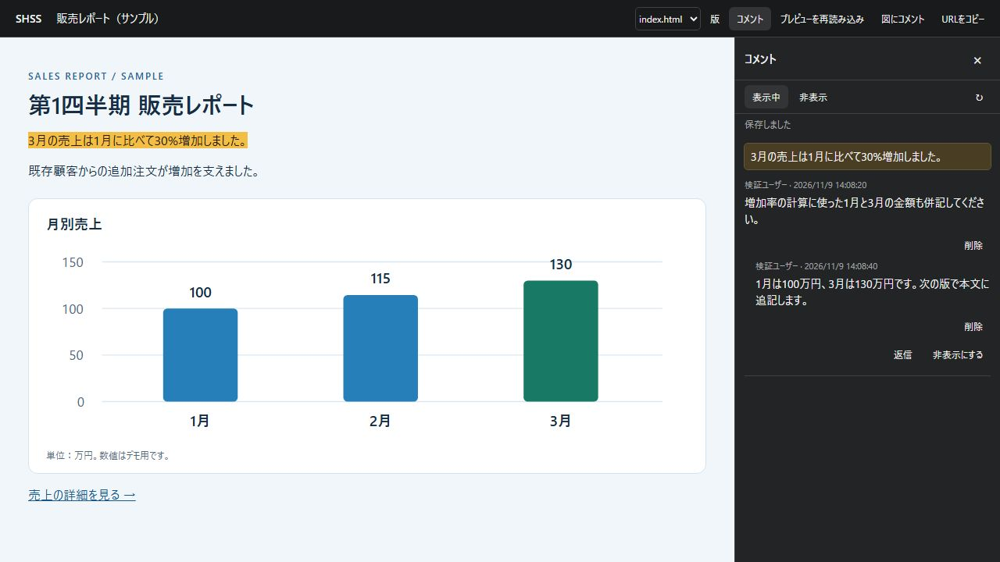
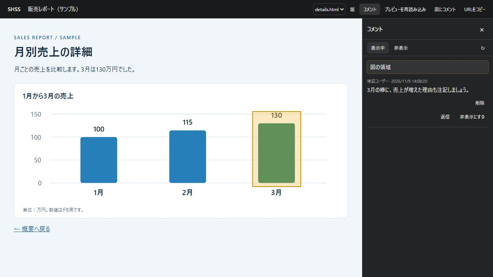

# Google SHSS

[English](README.en.md)

Google SHSS は、Google Workspace 内で HTML レポートや図をレビューするための Google Apps Script ウェブアプリです。文書の固定版とコメントを Google Drive に保存し、同じ版を開ける URL を共有できます。

## 画面と機能

以下は架空の販売レポートを使ったローカル実行画面です。

### 文章にコメントする

プレビュー内の文章を選択すると、右側に入力欄が開きます。**Ctrl+Enter** または **投稿** で送信できます。コメント欄の引用箇所を押すと対応する文章が強調表示されます。スレッドへの返信や、自分の投稿の削除もできます。



### 図の範囲にコメントする

**図にコメント** を選び、画像やグラフをクリックすると図全体を選択できます。一部だけを指定するときはドラッグで囲みます。下の画面では、3月の棒に付けた範囲コメントを表示しています。



### 参考文献などの外部リンク

文書内の HTTPS リンクをクリックすると、行き先が表示されます。確認して **別タブで開く** を選びます。

### 取り込み・ページ切り替え・共有

- **取り込み** で HTML、ZIP、静的 SVG を選ぶと取り込みが始まります。取り込み中にタイトルも編集できます。
- **ページ** メニューや文書内のリンクで ZIP の別ページに移動できます。コメントは版・ページごとに保存されます。
- **版** から過去の版を開けます。**URLをコピー** で、表示中の版とページに直接移動するリンクを共有できます。閲覧や投稿には対応する Drive 権限が必要です。
- **プレビューを再読み込み** で、HTML 内のボタンやタブなどの操作状態を初期表示に戻せます。

## 必要なもの

- Apps Script と Google Drive が使える Google Workspace アカウント
- Node.js 22 と npm（ビルド用）
- 取り込んだ文書を保存する専用の Google Drive フォルダ

## ビルド

```sh
git clone https://github.com/soudai/google-shss.git
cd google-shss
npm ci
npm run build
node --check < dist/gas/Code.gs
```

`dist/gas/` に `Code.gs`、`Index.html`、`appsscript.json` が生成されます。

`npm test` で、取り込み時の安全検査とコメント処理のテストを実行できます。`npm run check` は、テスト、ビルド、構文確認をまとめて実行します。

## Apps Script にデプロイ

1. [Apps Script](https://script.google.com/) でスタンドアロンのプロジェクトを作成します。「プロジェクトの設定」でマニフェストを表示し、生成した 3 ファイルを配置します。HTML ファイルの名前はエディタ上で `Index` にします。
2. 生成したマニフェストは [Advanced Drive Service（v3）](https://developers.google.com/apps-script/advanced/drive) を有効にします。標準 Google Cloud プロジェクトを関連付けている場合は、そのプロジェクトでも Google Drive API を有効にします。
3. 「プロジェクトの設定」から、次のスクリプト プロパティを追加します。

   | プロパティ | 値 |
   | --- | --- |
   | `SHSS_ROOT_FOLDER_ID` | 保存用 Drive フォルダの ID。フォルダ URL の `/folders/` の直後の部分です。 |
   | `SHSS_DOMAIN` | 利用者の Google Workspace メールドメイン。例は `example.com` です。 |

4. [新しいデプロイ](https://developers.google.com/apps-script/guides/web)で「ウェブアプリ」を選びます。実行ユーザーは **ウェブアプリにアクセスしているユーザー**、アクセスできるユーザーは **同じドメインのユーザー** に設定します。
5. 発行された `/exec` URL を対象アカウントで開き、Google Drive とメールアドレスの権限を許可します。

更新するときは生成ファイルを再配置し、「デプロイを管理」で既存のデプロイに新しいバージョンを割り当てます。配布済みの `/exec` URL を引き続き利用できます。

## 動作確認

1. 保存用フォルダにファイルを追加できるアカウントでウェブアプリを開きます。
2. 次を UTF-8 の `review-sample.html` として保存し、「取り込み」からファイルを選びます。

   ```html
   <!doctype html>
   <html lang="ja">
   <meta charset="utf-8">
   <title>レビューのサンプル</title>
   <p>この文章を選択して、コメントを投稿してください。</p>
   </html>
   ```

3. 文章を選択し、コメントを入力して **Ctrl+Enter** を押します。「保存しました」が表示されたら、ページを再読み込みして投稿を確認し、自分のコメントを削除します。
4. 別のアカウントで確認する場合は、Drive で対象の文書フォルダに閲覧権限を付与します。投稿を許可する相手には、そのフォルダ内の `comments.json` に編集権限も付与します。ウェブアプリの URL をコピーしても Drive の権限は変わりません。

## データと制限

- 取り込んだ文書、版情報、コメントは設定した Drive フォルダに保存されます。`comments.json` の編集権限がある利用者は Drive から直接ファイルを書き換えられます。アプリでのコメント削除は論理削除で、本文は JSON に残ります。
- 単一 HTML は UTF-8 で 10 MiB、静的 SVG は 512 KiB までです。ZIP は圧縮 10 MiB、展開後 20 MiB、100 ファイル、20 HTML ページまでです。ZIP 内のファイルは1件2 MiB（SVG は512 KiB）までです。Drive の URL やファイル ID から取り込めるのは単一 HTML です。
- ZIP には必要な画像、CSS、通常の JavaScript を同梱してください。外部 CDN や API、ES Modules、フォーム送信に依存するページは対象外です。HTML 内の JavaScript は隔離したプレビューで実行されるため、信頼できる作成者のファイルを使ってください。
- コメント本文は 2,000 文字までです。コメントの保存容量や操作履歴が上限に近づくと、新規投稿が制限されます。運用時は管理者だけが参照できる Drive フォルダへ定期的にバックアップしてください。

## ライセンス

[MIT](LICENSE)
